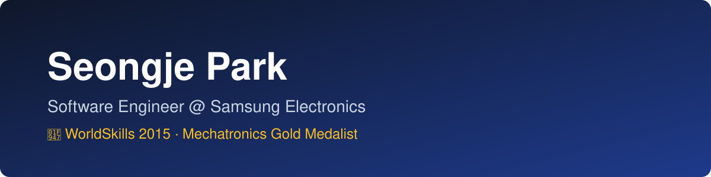

### 👋 안녕하세요, 박성제입니다

- 💼 **삼성전자** 개발자 (2022 ~ 현재)
- 🥇 **2015 국제기능올림픽(WorldSkills)** 메카트로닉스 금메달

### 🛠 Projects

- [SleepingGiant](https://github.com/sj-park-kr/SleepingGiant) — 급등주 찾기 프로그램
- [hackathon-harness](https://github.com/sj-park-kr/hackathon-harness) — AI 해커톤용 Claude Code 하네스
- [sk-hynix-hackathon](https://github.com/sj-park-kr/sk-hynix-hackathon) — SK하이닉스 해커톤 대비 연습실
- [matdangkke](https://github.com/sj-park-kr/matdangkke) — 연인 등 서로의 다툼을 중재해 주는 AI 상담사
